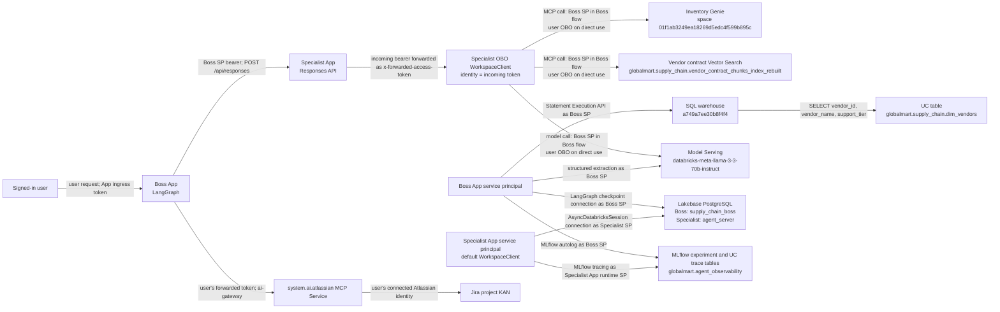
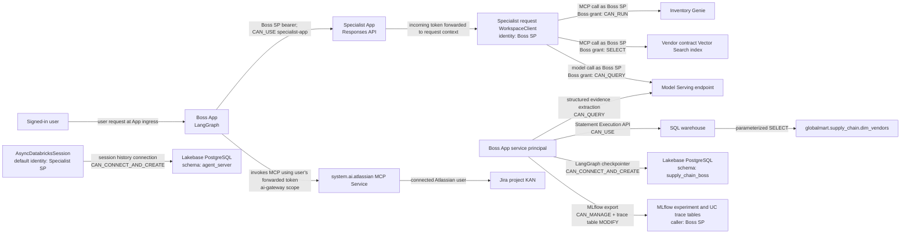
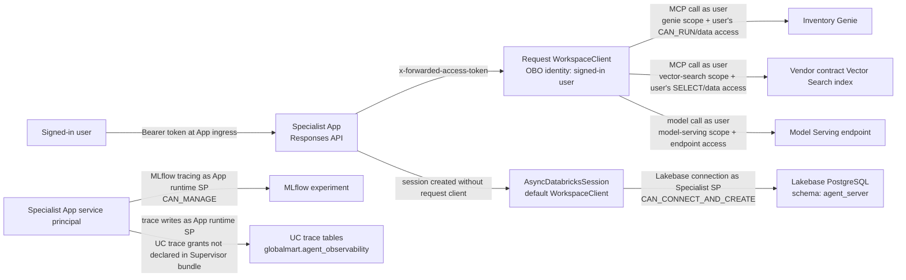
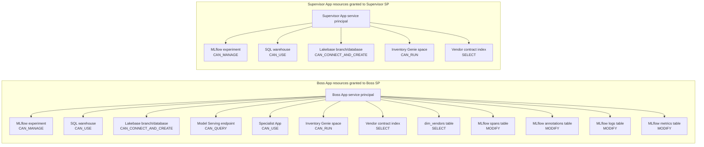

# Databricks Resources and Tool Access

This document describes the Databricks resources used by the supply-chain Boss
and Specialist Apps, how each is called, and which identity and permission
mechanism is used. The configuration evidence refers to the checked-in dev
bundle definitions; grants and scopes take effect in the workspace only after
the corresponding bundle is deployed.

Two permission mechanisms must not be conflated:

- **App resource permissions** in `resources/*.yml` grant a named permission
  (`CAN_RUN`, `SELECT`, `CAN_QUERY`, etc.) to the Databricks App's service
  principal. They are declared per App.
- **`user_api_scopes`** declare which API scopes an App may request for
  user-token/OBO operations. They are not UC grants and do not themselves give
  a user or service principal `SELECT`, `CAN_RUN`, or access to an object.
  The caller identity in the actual token still determines the principal
  evaluated by the target API.

Complete declared resource and scope lists are in the Boss
[`boss.resources.yml`](../agents/supply_chain_boss/resources/boss.resources.yml)
and Specialist
[`supervisor.resources.yml`](../agents/supply_chain_supervisor/resources/supervisor.resources.yml).

The Supervisor uses an OBO client created from the incoming
`x-forwarded-access-token` ([utils.py](../agents/supply_chain_supervisor/agent_server/utils.py)).
The Boss-to-Specialist client currently authenticates as the Boss App service
principal ([specialist.py](../agents/supply_chain_boss/agent_server/specialist.py)).
Consequently, Boss-originated Specialist calls use the Boss service principal's
resource grants for Genie and Vector Search, not the Specialist App service
principal's grants and not the signed-in user's data permissions.

## Runtime flow and identity

1. A user sends a request to the Boss App. The Boss LangGraph workflow uses a
   Lakebase checkpointer to retain workflow state, including interruptions for
   confirmation or manager approval.
2. For evidence, the Boss calls the Specialist Responses API at
   `/api/responses`, passing the question and conversation ID. The request is
   authenticated with the Boss App service principal. The original user's
   token is not forwarded to the Specialist in the current implementation.
3. The Specialist creates an OpenAI Agents SDK session, obtains the forwarded
   access token from the incoming App request, and exposes managed Vector
   Search and Genie MCP servers. In a Boss-to-Specialist request, the caller
   identity for that token is the Boss service principal.
4. The Specialist uses contract evidence from Vector Search and inventory
   evidence from Genie. The Boss separately reads the vendor support tier from
   `dim_vendors` through the SQL Statement Execution API.
5. Once the evidence is validated and the user confirms, the Boss creates any
   required approval or penalty work item through the `system.ai.atlassian`
   MCP Service. The current user's forwarded token is used for this Jira
   operation.

## End-to-end authorization diagram

This original end-to-end view is retained. It shows runtime calls only;
per-App resource grants are diagrammed separately below. Each arrow labels
whether the caller is an App service principal or an OBO identity.



In a Boss-originated request, the Specialist's OBO workspace client represents
the Boss service principal because the Boss calls the Specialist with its own
bearer token. In a direct-to-Specialist request, it represents the signed-in
user. The Specialist's own service principal is used by its Lakebase session
and App-runtime MLflow exporter, not by its request-scoped MCP/model client.

## Boss-to-Specialist end-to-end flow

This view follows a request that enters through Boss, including the different
identities used for data retrieval, checkpointing, tracing, and Jira.



In this flow the Specialist's Genie, Vector Search, and model requests carry
the Boss service principal's token. The user token is separately forwarded by
the Boss only for the Jira MCP operation. Boss checkpoints use the Boss
service principal; the Specialist's session store uses the Specialist App's
default credentials.

## Specialist direct-use end-to-end flow

This view shows a user calling the Specialist without going through Boss.
Request-scoped model and MCP calls use the signed-in user's OBO token, while
conversation history and App-level tracing use the Specialist App service
principal.



For this direct path, the Specialist's declared service-principal grants on
Genie and Vector Search do not replace the user's own permissions for the OBO
calls. The Supervisor bundle does not declare a serving-endpoint resource or
UC trace-table resources; access to the model is through the request identity,
and trace writes by the App service principal require separate UC grants.

## Per-App service-principal resource grants

This diagram contains only the resources declared in the Boss and Supervisor
bundle configurations. These grants belong to the corresponding App service
principal. They do not transfer to an OBO user or to another App's service
principal.



The Supervisor configuration does not declare a Model Serving endpoint grant
or UC trace-table grants. The Boss configuration declares `MODIFY` for all
four shared MLflow trace tables. These are configured App resource grants;
check the effective grants in the workspace after deploying each bundle.

## Code and configuration evidence

| Claim | Configuration evidence | Runtime/code evidence |
|---|---|---|
| Boss API scopes | [`boss.resources.yml`](../agents/supply_chain_boss/resources/boss.resources.yml) `user_api_scopes`: `ai-gateway`, `sql`, `genie`, `model-serving`, `vector-search`. | [`jira.py`](../agents/supply_chain_boss/agent_server/jira.py) uses the forwarded user token for Atlassian (`ai-gateway`). The Boss's SQL, model, checkpoint, and Specialist clients use default App credentials, so their principal is the Boss service principal; the declared Genie/Vector Search resource grants authorize its Specialist data path. |
| Specialist API scopes | [`supervisor.resources.yml`](../agents/supply_chain_supervisor/resources/supervisor.resources.yml) `user_api_scopes`: `sql`, `genie`, `model-serving`, `vector-search`. | [`utils.py`](../agents/supply_chain_supervisor/agent_server/utils.py) reads `x-forwarded-access-token` and creates `WorkspaceClient(token=..., auth_type="pat")`. |
| Boss calls Specialist with service-principal identity | Boss resources include `specialist-app` with `CAN_USE`. | [`specialist.py`](../agents/supply_chain_boss/agent_server/specialist.py) calls `self._workspace_client.config.authenticate()` and sends those headers to `/api/responses`; [`workflow.py`](../agents/supply_chain_boss/agent_server/workflow.py) creates the default `WorkspaceClient()`. |
| Specialist calls Genie and Vector Search through MCP | Specialist resources declare `genie-space: CAN_RUN` and `vector-search-index: SELECT`; `GENIE_SPACE_ID` is bound in [`app.yaml`](../agents/supply_chain_supervisor/app.yaml). | [`agent.py`](../agents/supply_chain_supervisor/agent_server/agent.py) builds both MCP URLs and passes the same request-scoped workspace client to each `McpServer`. |
| Boss SQL vendor-policy lookup | Boss resources declare `sql-warehouse: CAN_USE` and `vendor-policy-table: SELECT`. | [`policy.py`](../agents/supply_chain_boss/agent_server/policy.py) executes a parameterized `SELECT` with `statement_execution`; the runtime passes its default workspace client. |
| Model Serving caller identities | Boss declares `model-endpoint: CAN_QUERY`; both Apps declare the `model-serving` API scope. | Boss [`specialist.py`](../agents/supply_chain_boss/agent_server/specialist.py) uses the default `WorkspaceClient` for extraction; Specialist [`agent.py`](../agents/supply_chain_supervisor/agent_server/agent.py) constructs `AsyncDatabricksOpenAI` with the request-scoped OBO client. |
| Lakebase caller identities | Both resource files declare a `postgres` resource with `CAN_CONNECT_AND_CREATE`. | Boss [`workflow.py`](../agents/supply_chain_boss/agent_server/workflow.py) passes the default `WorkspaceClient` to `AsyncCheckpointSaver`. Specialist [`agent.py`](../agents/supply_chain_supervisor/agent_server/agent.py) calls `create_session()` without passing its OBO client, so `AsyncDatabricksSession` uses a default `WorkspaceClient()` (App service-principal identity). |
| MLflow trace identity and table access | Both declare `mlflow-experiment: CAN_MANAGE`. Boss additionally declares `MODIFY` resources for spans, annotations, logs, and metrics. The Supervisor config does not declare those UC trace-table resources. | Boss [`agent.py`](../agents/supply_chain_boss/agent_server/agent.py) enables `mlflow.langchain.autolog()`. Supervisor [`observability.py`](../agents/supply_chain_supervisor/agent_server/observability.py) configures a shared Unity Catalog trace location; the Supervisor's absence of table grants is a configuration gap if its App runtime identity writes there. |
| Jira authorization | Boss declares the `ai-gateway` API scope. Jira is not a Databricks App resource in these bundles. | [`jira.py`](../agents/supply_chain_boss/agent_server/jira.py) uses `current_user_access_token()` and connects to `system.ai.atlassian`; the user's connected Atlassian identity performs the Jira action. |

## Resource inventory

| Resource | Identifier | Used by and method | Access |
|---|---|---|---|
| Boss Databricks App | `agent-supply-chain-boss-dev` | Hosts the LangGraph workflow, Jira adapter, SQL policy lookup, and Specialist API client. | Its resource grants apply to the Boss App service principal. Declared API scopes: `ai-gateway`, `sql`, `genie`, `model-serving`, and `vector-search`. |
| Specialist Databricks App | `agent-supply-chain-sup-dev` | Hosts the Responses API and the evidence agent called by the Boss. | Boss App service principal has `CAN_USE`. Specialist declares `sql`, `genie`, `model-serving`, and `vector-search` scopes. Request-time MCP/model calls use the incoming OBO token identity. |
| MLflow experiment | `4341372968956549` | Both Apps use MLflow tracing/autologging. The Specialist binds tracing to the shared Unity Catalog trace location. | Each App declares `CAN_MANAGE` for the experiment. This does not grant Unity Catalog access to trace tables. |
| MLflow trace tables | `globalmart.agent_observability.contract_agent_traces_otel_spans`<br>`globalmart.agent_observability.contract_agent_traces_otel_annotations`<br>`globalmart.agent_observability.contract_agent_traces_otel_logs`<br>`globalmart.agent_observability.contract_agent_traces_otel_metrics` | MLflow writes OpenTelemetry spans, annotations, logs, and metrics for traces. | Boss config declares `MODIFY` on all four for the Boss App service principal. Supervisor config does not declare these table resources; tracing writes under its App runtime identity therefore need separate UC grants if enabled. |
| SQL warehouse | `a749a7ee30b8f4f4` | Boss runs a parameterized query through `statement_execution` against `dim_vendors`. Supervisor config also binds the warehouse ID for MLflow tracing. Genie inventory query execution uses the warehouse configured in the Genie space. | Both bundles declare `CAN_USE` for their App service principals. Boss's explicit policy lookup uses the Boss App's default service-principal client. |
| Vendor policy table | `globalmart.supply_chain.dim_vendors` | Boss retrieves `vendor_id`, `vendor_name`, and `support_tier` after the Specialist returns penalty evidence. | Boss declares `SELECT` for its service principal; this is read directly by the Boss's default service-principal client. |
| Inventory Genie space | `01f1ab3249ea18269d5edc4f599b895c` (`GlobalMart Inventory Genie`) | Specialist connects to `/api/2.0/mcp/genie/{space_id}`, discovers tools, and lets the model invoke Genie for inventory quantities, value, products, warehouses, and operational metrics. Genie may poll asynchronous query results. | Both Apps declare `CAN_RUN` for their own service principals and both declare the `genie` API scope. Actual Specialist MCP calls use its incoming OBO identity: Boss service principal in the Boss flow; signed-in user on direct use. Genie source data remains governed by its execution and Unity Catalog permissions. |
| Vendor contract Vector Search index | `globalmart.supply_chain.vendor_contract_chunks_index_rebuilt` | Specialist connects to `/api/2.0/mcp/vector-search/{catalog}/{schema}/{index}` and retrieves contract, penalty, waiver, and service-level evidence with source metadata. | Both Apps declare `SELECT` for their own service principals and both declare the `vector-search` API scope. Actual Specialist MCP calls use its incoming OBO identity (Boss service principal in the Boss flow; signed-in user on direct use). The index uses endpoint `globalmart-supply-chain-search`. |
| Model Serving endpoint | `databricks-meta-llama-3-3-70b-instruct` | Specialist generates answers through the OpenAI Agents SDK. Boss uses `AsyncDatabricksOpenAI` to extract structured penalty facts from Specialist evidence. | Boss declares `CAN_QUERY` for its service principal. Both Apps declare the `model-serving` API scope. Specialist's model client uses the incoming OBO identity; the Supervisor bundle has no serving-endpoint resource grant. |
| Lakebase PostgreSQL | Project `globalmart-supervisor-memory`, branch `production`, database `databricks-postgres` | Boss `AsyncCheckpointSaver` persists LangGraph state and approval interrupts in schema `supply_chain_boss`. Specialist `AsyncDatabricksSession` persists conversation history in schema `agent_server`. | Both Apps declare `CAN_CONNECT_AND_CREATE` for their service principals. In current code, both Lakebase clients use a default App service-principal `WorkspaceClient`; the Supervisor does not pass its request OBO client into session construction. Each uses an isolated schema. |
| Atlassian MCP Service | `system.ai.atlassian` via `{workspace-host}/ai-gateway/mcp-services/system.ai.atlassian` | Boss looks up Jira account IDs, creates Jira issues, and adds comments through the MCP tools. | `ai-gateway` scope and the signed-in user's forwarded token. Jira project `KAN` is external to Databricks. |
| Unity Catalog data namespace | Catalog `globalmart`; schema `supply_chain` | Contains the vendor policy table and contract index; Genie is configured over inventory gold data in this domain. Agent code directly queries only `dim_vendors`; Genie owns its SQL generation and execution. | Catalog/schema privileges and table/index-specific grants, as applicable. |

## Tool and permission details

### Genie and Vector Search

The Specialist creates both MCP servers with the request's Databricks workspace
client, calls `list_tools()` as a health check, and passes available servers to
the Agents SDK. The model selects tools during the run. If a server cannot be
connected or its tools cannot be listed, the Specialist marks that source
unavailable instead of claiming evidence from it.

The Boss App's Genie and index resources are separate from its `genie` and
`vector-search` scopes. Resource grants authorize the App service principal on
the Genie space or index; API scopes allow the relevant scoped workspace API
operations in user/OBO flows. Neither mechanism substitutes for the effective
caller identity's permissions. For an end-user direct Specialist request the
caller is that user; for a Boss-originated Specialist request, the caller is
the Boss service principal. The Supervisor's own resource grants authorize its
service principal but are not automatically inherited by requests authenticated
as another principal.

### SQL and Model Serving

The Boss SQL policy lookup uses a bound `vendor_id` parameter and a 90-second
polling limit. It does not ask the model to write SQL. The Boss's model call is
used for structured evidence extraction, not for retrieving source facts.
Inventory and contract facts remain the responsibility of Genie and Vector
Search, respectively.

### Jira

The Jira adapter selects and validates the MCP tools `lookupJiraAccountId`,
`createJiraIssue`, and `addCommentToJiraIssue`. It obtains the current user's
forwarded token and builds an authenticated Databricks client for the
`system.ai.atlassian` MCP Service. The workflow gates issue creation on
evidence, user confirmation, and the configured support-tier approval policy.

### MLflow and Unity Catalog permissions

The observed Boss tracing failures were `USE SCHEMA` and table privileges
denied on `globalmart.agent_observability` for the Boss App service principal.
An MLflow experiment grant does not grant Unity Catalog access to the backing
trace tables. The Boss bundle therefore declares `MODIFY` on the spans,
annotations, logs, and metrics tables. If bundle deployment cannot grant those
resources, a Unity Catalog owner must grant the equivalent catalog, schema,
and table privileges to the Boss App service principal.

### Service-principal boundary

The Boss-to-Specialist HTTP call currently uses the Boss App service principal;
the original user's OAuth token is not passed through. This means data access
for that path is governed by the Boss service principal's effective permissions,
not per-user data permissions. `user_api_scopes` do not by themselves change
that identity boundary. Forwarding the authenticated user's token end to end
remains a separate design change.

## Deployment and verification

Validate and deploy the two bundles separately:

```bash
cd agents/supply_chain_boss
databricks bundle validate -t dev --profile dbai-dev
databricks bundle deploy -t dev --profile dbai-dev

cd ../supply_chain_supervisor
databricks bundle validate -t dev --profile dbai-dev
databricks bundle deploy -t dev --profile dbai-dev
```

Deployment must be performed by an identity permitted to grant the declared
App resources. After deployment, inspect each App's `user_api_scopes` and
resources, then verify Genie inventory, Vector Search contract evidence, the
vendor policy lookup, and MLflow trace export. Check the principal named in
each permission error: an App resource grant does not replace permissions for
a different OBO caller or for the resource's separate execution identity.
