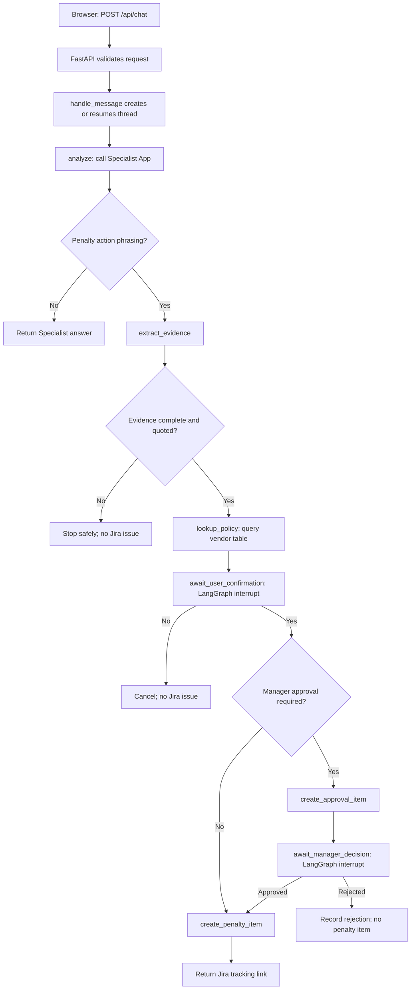
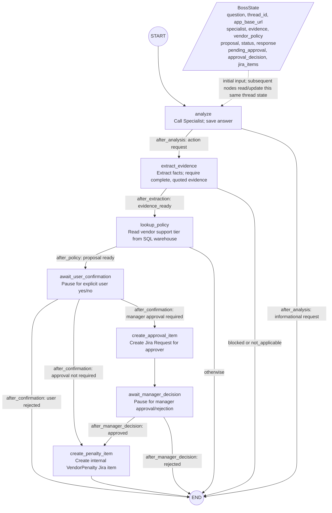

# Boss App Code Walkthrough

This guide follows one request through the GlobalMart Supply Chain Boss App. It
assumes no prior LangGraph experience and explains how the Boss calls the
read-only Specialist App, reads Unity Catalog data, and uses Jira MCP for
internal work items.

The Boss does **not** execute a contract penalty, contact a vendor, or charge a
vendor. Jira issues created by this workflow are internal tracking records.

## The short version

The browser sends a message to the Boss. The Boss asks the Specialist for
contract evidence. Ordinary questions return the answer. A request to take
penalty-related action follows additional checks: evidence must be complete,
the vendor's support tier is read from Unity Catalog, and the user must confirm
the exact proposal. Some tiers then require a separate manager decision. Only
after all required decisions does the Boss create a Jira tracking issue.



## How to think about LangGraph

LangGraph is the coordinator here. It is not the language model and it is not a
replacement for the Specialist, SQL warehouse, or Jira. The Boss uses a
`StateGraph` to connect Python functions into a directed workflow:

- **State** is the data passed between steps. The `BossState` type in
  [`workflow.py`](../agents/supply_chain_boss/agent_server/workflow.py)
  describes fields such as the user's question, Specialist result, evidence,
  proposal, status, and Jira references.
- **Nodes** are functions that read state and return updates. For example,
  `analyze` calls the Specialist; `lookup_policy` calls the SQL warehouse.
- **Edges** decide which node runs next. Some are fixed, and some are
  conditional. For example, `after_analysis` chooses whether to run the
  penalty-specific evidence steps.
- **Interrupts** pause execution for a human decision. `interrupt(...)`
  returns a prompt to the caller without losing the workflow position.
- **Checkpoints** store state between requests. The graph is compiled with a
  checkpointer and each conversation is assigned a thread ID. The deployed App
  uses Lakebase; the in-memory checkpointer is for local development only.
- **Resume** starts the paused graph where it stopped. The caller uses
  `Command(resume=...)` with the same thread configuration.

### The Boss graph: state, nodes, and edges

This diagram is a view of the graph built in `build_graph`. The `BossState`
box represents the shared data for one thread. LangGraph passes the current
state into each node; each node returns only the fields it changed, and
LangGraph merges those updates into the state passed along the next edge. The
state is checkpointed against the thread ID so an interrupt can be resumed in
a later HTTP request.



The rectangles are **nodes**: named Python functions registered with
`builder.add_node`. The arrows are **edges** registered with `add_edge` or
`add_conditional_edges`; labels show the branch conditions selected by the
`after_*` routing functions. `START` and `END` are LangGraph sentinels rather
than application nodes. The decision branches do not add a separate node:
they are conditional edges out of the preceding application node.

| Graph element | What it means in this workflow |
|---|---|
| `BossState` | The typed, checkpointable per-conversation data described above. It contains serializable results and decisions, not access tokens. |
| `analyze` | Calls the Specialist and saves its answer and custom outputs. |
| `extract_evidence` | Extracts penalty details and blocks incomplete or unsupported proposals. |
| `lookup_policy` | Looks up the vendor and derives `approval_required`. |
| `await_user_confirmation` | Uses a LangGraph interrupt to pause for the requester. |
| `create_approval_item` | Creates the manager's Jira `Request` and stores its references in state. |
| `await_manager_decision` | Uses a second interrupt; on resume, adds the decision comment to the approval issue. |
| `create_penalty_item` | Creates the internal penalty-tracking Jira issue after all required approvals. |
| Conditional edges | Route based on action wording, evidence status, user's answer, and manager approval. |

The graph definition and its nodes are in
[`workflow.py`](../agents/supply_chain_boss/agent_server/workflow.py).
`BossRuntime` owns the compiled graph and open resources. It is created during
startup by `create_runtime_async`; the server closes it during shutdown.

## Request walkthrough

### 1. The UI sends a turn

The Boss chat page in
[`static/index.html`](../agents/supply_chain_boss/static/index.html) keeps a
conversation ID in same-origin browser storage and sends:

```http
POST /api/chat
Content-Type: application/json
```

```json
{
  "message": "What penalty applies to VEND-789 for a late delivery?",
  "conversation_id": "a-client-generated-conversation-id"
}
```

This example asks about a penalty, but it does not by itself authorize an
action. The server still requires explicit confirmation and, depending on
policy, manager approval.

### 2. FastAPI validates and adds trusted request context

[`start_server.py`](../agents/supply_chain_boss/agent_server/start_server.py)
implements `/api/chat`. It rejects blank messages and missing conversation
IDs, then extracts the user's identity, forwarded access token, and HTTPS App
origin from Databricks App ingress headers. The App middleware also restores a
sampled incoming MLflow trace context, when present.

The access token is not copied into graph state. The Boss keeps it in a
request-scoped `ContextVar` only while user-governed tools need it. The current
MVP calls the Specialist with the Boss App's service-principal authorization;
it does not forward the browser user's identity to that child App.

### 3. The request becomes a LangGraph thread

`handle_message` in `workflow.py` combines the trusted user identity (or the
literal `"anonymous"` fallback) and browser conversation ID, then hashes them
to create the LangGraph `thread_id`. The hash keeps raw identity out of the
checkpoint key. The graph receives the thread through:

```python
config = {"configurable": {"thread_id": thread_id}}
```

If this is a new turn, the Boss builds an initial state containing the
question, thread ID, App origin, and empty result fields, then calls:

```python
await runtime.graph.ainvoke(initial_state, config=config)
```

If there is already a pending user-confirmation interrupt, the next chat turn
is parsed as yes/no and the Boss resumes the graph instead of starting over. A
conversation paused for manager approval cannot be approved by replying in the
chat; it must use the approval page/API.

### 4. The `analyze` node calls the Specialist

The first graph node is `analyze`. It calls `SpecialistClient.ask(question,
thread_id)` in
[`specialist.py`](../agents/supply_chain_boss/agent_server/specialist.py).
That client:

1. Looks up the configured Specialist App using the Databricks SDK.
2. Gets the App URL and authenticates with the Boss App's service principal.
3. Forwards the active MLflow trace context when available.
4. Sends a non-streaming request to the Specialist's `/api/responses`.
5. Parses the response text and `custom_outputs` into `SpecialistResult`.

The request body sent to the Specialist has this shape:

```json
{
  "input": [
    {
      "role": "user",
      "content": "What penalty applies to VEND-789 for a late delivery?"
    }
  ],
  "context": {
    "conversation_id": "the-LangGraph-thread-id"
  },
  "stream": false
}
```

The actual URL is discovered from the configured App name; the code appends
`/api/responses`. Authentication headers come from the Databricks workspace
client and are not included above.

The Specialist's implementation is in
[`agents/supply_chain_agent/src/agent_server/agent.py`](../agents/supply_chain_agent/src/agent_server/agent.py).
It searches active contract evidence first, then uses its configured model to
write an answer from that evidence. The contract evidence is returned
separately in `custom_outputs.contract_evidence`.

### 5. LangGraph selects the information or action path

After `analyze`, the conditional edge `after_analysis` checks the question
against the Boss's penalty-action phrase matcher:

- If it is not recognized as an action request, the graph ends with the
  Specialist answer. It does not read the vendor policy table or create Jira
  work.
- If it is recognized, the graph continues to `extract_evidence`.

This phrase check is a routing gate, not a decision that a penalty is valid.
The evidence and confirmation steps still have to pass.

### 6. Evidence is extracted and checked

`extract_evidence` uses `PenaltyEvidenceExtractor` from
[`specialist.py`](../agents/supply_chain_boss/agent_server/specialist.py).
If the Specialist already returned a structured `penalty_evidence` object,
the Boss validates it. Otherwise, the extractor asks the configured
Databricks model for schema-constrained JSON containing fields such as
`penalty_applicable`, `vendor_id`, `amount`, `currency`, `contract_basis`, and
citations.

The model is only an extractor: the Boss checks that the quotes in the
contract basis, amount quote, and citations occur in the Specialist answer.
`extract_evidence` also requires an affirmative applicability value, vendor
identity, explicit positive amount and currency, and citations. Missing or
invalid facts set the status to `blocked`, return an explanation, and stop
before Jira.

### 7. The Boss reads the vendor's policy from Unity Catalog

For complete evidence, `lookup_policy` calls
`VendorPolicyLookup.lookup(vendor_id)` in
[`policy.py`](../agents/supply_chain_boss/agent_server/policy.py). It uses
Databricks Statement Execution with the configured SQL warehouse and a bound
parameter:

```sql
SELECT vendor_id, vendor_name, support_tier
FROM globalmart.supply_chain.dim_vendors
WHERE vendor_id = :vendor_id
```

The `vendor_id` is sent separately as a `STRING` parameter, rather than being
interpolated into the SQL. The implementation requires exactly one matching
vendor and a non-empty `support_tier`. It then applies
`APPROVAL_REQUIRED_SUPPORT_TIERS` (case-insensitively) to decide whether a
manager is required.

The result is combined with the Specialist evidence into a `PenaltyProposal`.
This is the exact set of details the user is asked to confirm. This table
lookup is separate from contract search: the Specialist retrieves contract
text, while the Boss reads the support-tier policy.

### 8. User confirmation pauses the graph

`await_user_confirmation` calls LangGraph's `interrupt` with the proposal and
a prompt. The request returns with an `awaiting_user_confirmation` status. No
Jira item has been created yet.

When the user replies yes or no, `/api/chat` calls `handle_message` again. It
finds the pending interrupt and resumes the same checkpointed thread with:

```python
Command(resume={"approved": True})   # or False
```

An ambiguous answer does not resume the graph; the UI asks the user to reply
explicitly yes or no. A no ends the request without a Jira item.

### 9. The policy determines whether a second approval is needed

After a yes, `after_confirmation` examines `proposal.approval_required`.

- **No manager approval required:** go directly to `create_penalty_item`.
- **Manager approval required:** create a separate approval request, then pause
  at `await_manager_decision`.

The required tiers are configured through
`APPROVAL_REQUIRED_SUPPORT_TIERS`; the deployed default is `Gold,Platinum`.

## Calling the Unity Catalog contract-search object

The Specialist—not the Boss policy lookup—uses the governed Unity Catalog
function `globalmart.supply_chain.search_vendor_contracts`. Its implementation
is in
[`data_tools.py`](../agents/supply_chain_agent/src/agent_server/data_tools.py).
The function is backed by the managed AI Search index and returns ranked
contract chunks and source metadata. The Specialist's search builds a query
equivalent to:

```sql
SELECT
  source_file, chunk_index, vendor_id, vendor_name,
  support_tier, region_covered, chunk_text, score
FROM globalmart.supply_chain.search_vendor_contracts(
  'weather delay penalty',
  'VEND-789',
  NULL,
  NULL
)
ORDER BY score DESC
LIMIT 10
```

The first argument is search text, followed by optional vendor, support-tier,
and region filters. The real implementation obtains the catalog and warehouse
from App configuration, escapes string values as SQL literals, executes the
statement through the Databricks SDK, and checks the final statement status.
It uses the requesting token forwarded to the Specialist App when available.
In the current Boss-to-Specialist integration, that token is the Boss App's
service-principal token, not the original browser user's token; end-user OBO
forwarding is a documented follow-up.

The two UC objects therefore serve different purposes:

| Unity Catalog object | Used by | Purpose |
|---|---|---|
| `globalmart.supply_chain.search_vendor_contracts` | Specialist | Find active contract chunks and citations |
| `globalmart.supply_chain.dim_vendors` | Boss | Resolve support tier and approval requirement |

## Calling Jira MCP

Jira is accessed through the Databricks Atlassian MCP Service, not by calling
Jira REST endpoints directly. `JiraMcpClient` in
[`jira.py`](../agents/supply_chain_boss/agent_server/jira.py) discovers tools
from the configured service URL, defaulting to:

```text
{workspace-host}/ai-gateway/mcp-services/system.ai.atlassian
```

It requires the forwarded user's Databricks token, discovers the MCP tool
schemas, rejects missing/unknown arguments, and requires a unique tool match.
Before issue creation it resolves the configured assignee email to exactly one
Jira account ID with `lookupJiraAccountId`.

The approval-item path then makes a call equivalent to:

```python
await tool.ainvoke({
    "projectKey": "KAN",
    "issueTypeName": "Request",
    "summary": "Approval required: vendor penalty for Alpine Apparel",
    "description": "Proposal, contract basis, and Boss approval-page link...",
    "assignee_account_id": approver_account_id,
    "contentFormat": "markdown",
})
```

The Boss uses the MCP tool named `createJiraIssue`. For a tier not requiring
manager approval, the same operation creates a `VendorPenalty` tracking issue
assigned to the configured penalty assignee after user confirmation. For a
tier requiring manager approval, the sequence is:

1. `createJiraIssue` creates a `Request` assigned to the approver.
2. The graph pauses for the decision on the Boss approval page.
3. The approval endpoint resumes the checkpointed thread.
4. `addCommentToJiraIssue` records approved/rejected on the request.
5. Only an approval proceeds to another `createJiraIssue`, this time for the
   `VendorPenalty` tracking item.

The user's token is kept in async request context for MCP calls; it is not
checkpointed. This differs from the SQL policy lookup and Specialist request,
which currently use the Boss service principal. The configured Jira identity
must be connected and authorized to create/assign the issue types.

## How the approval page resumes the graph

The Boss stores a pending approval record in graph state with the thread ID,
Jira issue key/URL, and approval URL. The custom approval page calls:

- `GET /api/approvals/{thread_id}` to load a matching pending request.
- `POST /api/approvals/{thread_id}` with
  `{"decision":"approve"}` or `{"decision":"reject"}` to submit the decision.

The route validates the opaque thread ID and JSON decision, then calls
`decide_manager_approval`. That function verifies that the current graph
interrupt and checkpoint record both refer to the same still-pending request
before resuming with `Command(resume=...)`. The graph, not the browser, decides
whether the next step can create a penalty-tracking item.

**MVP security note:** the current approval route permits any authenticated
App user to decide; manager-role authorization, CSRF/origin protection, and
verified approver identity remain hardening tasks. See the security follow-ups
in the [Boss App README](../agents/supply_chain_boss/README.md).

## Where to read next

1. Start with [`workflow.py`](../agents/supply_chain_boss/agent_server/workflow.py)
   and follow `build_graph` from `START` through its conditional edges.
2. Follow the integrations in
   [`specialist.py`](../agents/supply_chain_boss/agent_server/specialist.py),
   [`policy.py`](../agents/supply_chain_boss/agent_server/policy.py), and
   [`jira.py`](../agents/supply_chain_boss/agent_server/jira.py).
3. Read [`start_server.py`](../agents/supply_chain_boss/agent_server/start_server.py)
   to see how HTTP routes call graph helpers.
4. Review the [Boss App README](../agents/supply_chain_boss/README.md) for
   deployment configuration and operational/security follow-ups.
